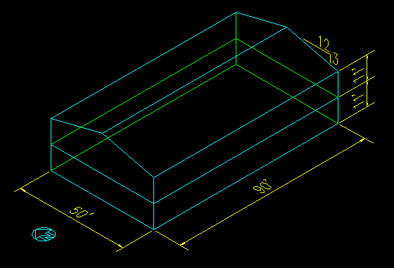
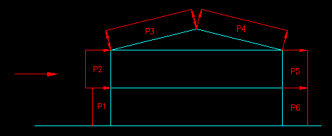
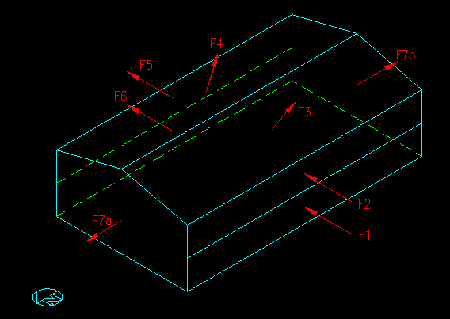
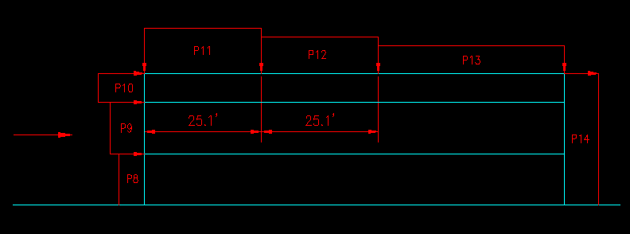
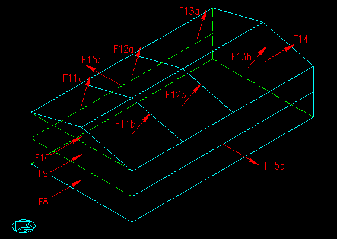

# Example 1: Two-story office building (ASCE 7-05 Method 2)

**Source:** T. Bartlett Quimby, *A Beginner's Guide to ASCE 7-05*, Chapter 7 "W: Wind Loads",
Section 7.4.1, Example Problem 7.1 "Two Story Building, Method 2" (© 2007, last revised 11/04/2014).
The text, tables and figures below are imported from that example. The figures are the author's own GIFs, copied here.

**Why this one:** it is a complete hand calculation of a gable building. It covers:
- velocity pressures at three heights;
- Fig. 6-6 Cp for walls and roof, both normal to and parallel to the ridge;
- the two roof values (four cases with ±GCpi);
- every surface force resolved into horizontal and vertical totals.

ASCE 7-05 Method 2 is today's Chapter 27 directional procedure:
- Fig. 6-6 is Fig. 27.3-1 (Cp);
- G = 0.85 and GCpi = ±0.18 are unchanged;
- with I = 1.0, q = 0.00256 Kz Kzt Kd V² I equals ASCE 7-16's q (Kd in q, Ke = 1).

The tests therefore run it as ASCE 7-16 Chapter 27.

---

## Given

The enclosed office building shown in Figure 7.4.1.1. The building is in a region with a wind speed (3-sec gust) of 120 mph, Exposure C, on flat terrain.

*Figure 7.4.1.1: building definition. 50 ft × 90 ft, two 11 ft stories, 3:12 gable spanning the 50 ft.*

**Wanted:** the wind pressures applied to the surfaces, and the net forces applied to the building.

## Critical elevations

| | |
|---|---|
| Mean roof height | h = 2·11' + (3/12)·25'/2 = 25.1 ft |
| Mean 2nd floor height | 11' + 11'/2 = 16.5 ft |
| Mean 1st floor height | 11'/2 = 5.5 ft |

## Velocity pressures, qz = 0.00256 Kz Kzt Kd V² I (Eq. 6-15)

Kzt = 1 (flat terrain); Kd = 0.85 (Table 6-4, buildings); I = 1.0 (Category II); Kz = 2.01(max(h,15)/900)^(2/9.5).

| | h (ft) | Kz | qz (psf) |
|---|---|---|---|
| Roof | 25.125 | 0.946 | 29.7 |
| 2nd flr | 16.5 | 0.866 | 27.1 |
| 1st flr | 5.5 | 0.849 | 26.6 |

Internal pressure:
- GCpi = ±0.18 (Fig. 6-5);
- qh = 29.7 psf;
- qh·GCpi = ±5.34 psf.

Gust factor: G = 0.85 (6.5.8.1).

## Wind in the N/S direction (normal to the ridge)

*Figure 7.4.1.2: N/S building section. P1 and P2 windward wall, P3 windward roof, P4 leeward roof, P5 and P6 leeward wall.*

Wall coefficients (Fig. 6-6):
- **Windward wall (P1, P2):** Cp = 0.8 at all heights.
- **Leeward wall (P5, P6):** L/B = 50/90 = 0.556, so Cp = −0.50.
- **Side walls:** Cp = −0.7.

> For the roof, the slope angle is 14.0 degrees. This is close to 15 degrees and probably not worth interpolating between the
> values given in ASCE 7-05 Figure 6-6. We also need to know that h/L = 25.1'/50' = 0.50. From the Figure we get that the
> values of Cp for the Windward side of the roof is −0.70 and −0.18. These values represent two different load cases. For
> the Leeward side, Cp is −0.50.

| Surface | | Cp | q (psf) | qGCp (psf) |
|---|---|---|---|---|
| Windward wall | P1 | 0.8 | 26.6 | 18.1 |
| | P2 | 0.8 | 27.1 | 18.5 |
| Windward roof | P3 | −0.7 | 29.7 | −17.6 |
| | P3 | −0.18 | 29.7 | −4.5 |
| Leeward roof | P4 | −0.5 | 29.7 | −12.6 |
| Leeward wall | P5, P6 | −0.5 | 29.7 | −12.6 |
| Side walls | P7 | −0.7 | 29.7 | −17.6 |

The four load cases:

| Case | Windward roof pressure | Internal pressure |
|---|---|---|
| I | −17.6 psf (maximum) | positive |
| II | −4.5 psf (minimum) | positive |
| III | −17.6 psf (maximum) | negative |
| IV | −4.5 psf (minimum) | negative |

Net pressures and forces use actual surface areas. Negative means outward from the surface. Each force is normal to its surface.

| Surface | | I (psf) | II | III | IV | Area (ft²) | I (k) | II (k) | III (k) | IV (k) |
|---|---|---|---|---|---|---|---|---|---|---|
| Windward wall | P1 | 12.8 | 12.8 | 23.4 | 23.4 | 990 | 12.62 | 12.62 | 23.19 | 23.19 |
| | P2 | 13.1 | 13.1 | 23.8 | 23.8 | 990 | 12.99 | 12.99 | 23.55 | 23.55 |
| Windward roof | P3 | −23.0 | −9.9 | −12.3 | 0.8 | 2319 | −53.29 | −22.90 | −28.54 | 1.86 |
| Leeward roof | P4 | −17.9 | −17.9 | −7.3 | −7.3 | 2319 | −41.60 | −41.60 | −16.85 | −16.85 |
| Leeward wall | P5 | −17.9 | −17.9 | −7.3 | −7.3 | 990 | −17.76 | −17.76 | −7.19 | −7.19 |
| | P6 | −17.9 | −17.9 | −7.3 | −7.3 | 990 | −17.76 | −17.76 | −7.19 | −7.19 |
| Side walls | P7 | −23.0 | −23.0 | −12.3 | −12.3 | 1413 | −32.46 | −32.46 | −17.38 | −17.38 |

*Figure 7.4.1.3: building forces for N/S wind.*

Global components (k), E/W · N/S · vertical:

| Force | I E/W | I N/S | I vert | II E/W | II N/S | II vert | III E/W | III N/S | III vert | IV E/W | IV N/S | IV vert |
|---|---|---|---|---|---|---|---|---|---|---|---|---|
| F1 | 0 | 12.62 | 0 | 0 | 12.62 | 0 | 0 | 23.19 | 0 | 0 | 23.19 | 0 |
| F2 | 0 | 12.99 | 0 | 0 | 12.99 | 0 | 0 | 23.55 | 0 | 0 | 23.55 | 0 |
| F3 | 0 | −12.93 | 51.70 | 0 | −5.55 | 22.22 | 0 | −6.92 | 27.69 | 0 | 0.45 | −1.80 |
| F4 | 0 | 10.09 | 40.36 | 0 | 10.09 | 40.36 | 0 | 4.09 | 16.34 | 0 | 4.09 | 16.34 |
| F5 | 0 | 17.76 | 0 | 0 | 17.76 | 0 | 0 | 7.19 | 0 | 0 | 7.19 | 0 |
| F6 | 0 | 17.76 | 0 | 0 | 17.76 | 0 | 0 | 7.19 | 0 | 0 | 7.19 | 0 |
| F7a | −32.46 | 0 | 0 | −32.46 | 0 | 0 | −17.38 | 0 | 0 | −17.38 | 0 | 0 |
| F7b | 32.46 | 0 | 0 | 32.46 | 0 | 0 | 17.38 | 0 | 0 | 17.38 | 0 | 0 |
| **Sum** | 0 | **58.29** | **92.06** | 0 | **65.66** | **62.58** | 0 | **58.29** | **44.03** | 0 | **65.66** | **14.54** |

> Note that the maximum uplift and maximum horizontal force do not occur in the same load cases! ... You will also notice
> that the internal pressure has no effect on the net horizontal force.

## Wind in the E/W direction (parallel to the ridge)

*Figure 7.4.1.4: E/W building section. P8 to P10 windward wall, P11 to P13 roof bands, P14 leeward wall.*

The leeward wall Cp is interpolated at L/B = 1.8.

| Surface | | Cp | q (psf) | qGCp (psf) |
|---|---|---|---|---|
| Windward wall | P8 | 0.8 | 26.6 | 18.1 |
| | P9 | 0.8 | 27.1 | 18.5 |
| | P10 (gable) | 0.8 | 29.7 | 20.2 |
| Roof, 0 to h | P11 | −0.9 / −0.18 | 29.7 | −22.7 / −4.5 |
| Roof, h to 2h | P12 | −0.5 / −0.18 | 29.7 | −12.6 / −4.5 |
| Roof, > 2h | P13 | −0.3 / −0.18 | 29.7 | −7.6 / −4.5 |
| Leeward wall | P14 | −0.34 | 29.7 | −8.6 |
| Side walls | P15 | −0.7 | 29.7 | −17.6 |

*Figure 7.4.1.5: building forces for E/W wind ("a" and "b" are the two slopes).*

| Surface | | I (psf) | II | III | IV | Area (ft²) | I (k) | II (k) | III (k) | IV (k) |
|---|---|---|---|---|---|---|---|---|---|---|
| Windward wall | P8 | 12.8 | 12.8 | 23.4 | 23.4 | 550 | 7.01 | 7.01 | 12.88 | 12.88 |
| | P9 | 13.1 | 13.1 | 23.8 | 23.8 | 550 | 7.21 | 7.21 | 13.09 | 13.09 |
| | P10 | 14.8 | 14.8 | 25.5 | 25.5 | 156 | 2.32 | 2.32 | 3.98 | 3.98 |
| Roof | P11a, b | −28.0 | −9.9 | −17.3 | 0.8 | 647 each | −18.12 | −6.39 | −11.22 | 0.52 |
| | P12a, b | −17.9 | −9.9 | −7.3 | 0.8 | 647 each | −11.60 | −6.39 | −4.70 | 0.52 |
| | P13a, b | −12.9 | −9.9 | −2.2 | 0.8 | 1026 each | −13.23 | −10.13 | −2.28 | 0.82 |
| Leeward wall | P14 | −13.9 | −13.9 | −3.2 | −3.2 | 1256 | −17.47 | −17.47 | −4.06 | −4.06 |
| Side walls | P15a, b | −23.0 | −23.0 | −12.3 | −12.3 | 1980 each | −45.50 | −45.50 | −24.36 | −24.36 |

Global components (k), vertical, per roof slope (a and b are equal; their N/S parts cancel):

| Case | F11 | F12 | F13 |
|---|---|---|---|
| I | 17.58 | 11.26 | 12.83 |
| II | 6.20 | 6.20 | 9.82 |
| III | 10.88 | 4.56 | 2.21 |
| IV | −0.50 | −0.50 | −0.80 |

**Sums:**

| Case | E/W (k) | N/S (k) | Vertical (k) |
|---|---|---|---|
| I | **34.01** | 0 | **83.34** |
| II | **34.01** | 0 | **44.43** |
| III | **34.01** | 0 | **35.31** |
| IV | **34.01** | 0 | **−3.60** |

---

## What the tests check (`ASCE7Wind.Tests/PublishedExampleTests.cs`, `Ex1_*`)

Model: 90 ft (x, E-W) × 50 ft (y), levels at 11 and 22 ft, gable pitch atan(3/12) with the ridge W-E, V 120, Exposure C, ASCE 7-16.

| Test | Published | Result |
|---|---|---|
| h, qh, qz at 16.5 and 5.5 ft, GCpi, qh·GCpi | 25.1; 29.7; 27.1; 26.6; 0.18; 5.34 | **pass** |
| E/W Cp: leeward −0.34, roof bands −0.9 / −0.9 / −0.5 / −0.3, all −0.18, band plan areas | as above | **pass** |
| Horizontal totals: N/S 65.66 (governing), E/W 34.01 | 65.66; 34.01 | **pass** |
| E/W uplift, Cases I and II | 83.34; 44.43 | **pass** |
| N/S Cp: walls 0.8 / −0.5 / −0.7, leeward roof −0.5, windward −0.18 | as above | **pass** |
| N/S windward roof Cp, first value | −0.70 (15° value) | **pass**: checks −0.74, interpolated at 14.04° |
| N/S uplift, Case II / Case I | 62.58; 92.06 | **pass**: II as printed; I reproduced with the example's −0.70 put in, 94.37 with −0.74 |

**The windward roof value is the example's simplification, not the program's.** The author takes the 15° row for a 14.04° roof ("not worth interpolating"). Fig. 27.3-1 interpolated at 14.04° and h/L = 0.50 gives −0.74. The 2.3 k difference in Case I uplift is exactly that 0.04 × qh·G × 2319 ft². Rounding the angle up is the usual hand shortcut, but here it is slightly unconservative: between 10° (−0.9) and 15° (−0.7) the suction falls as the angle rises.
