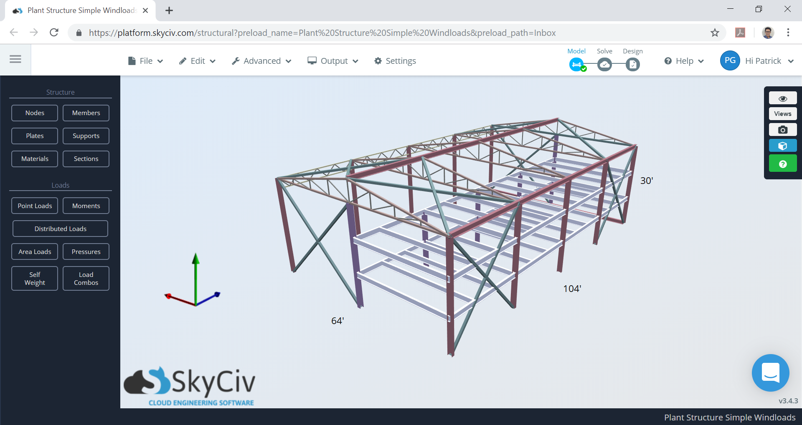
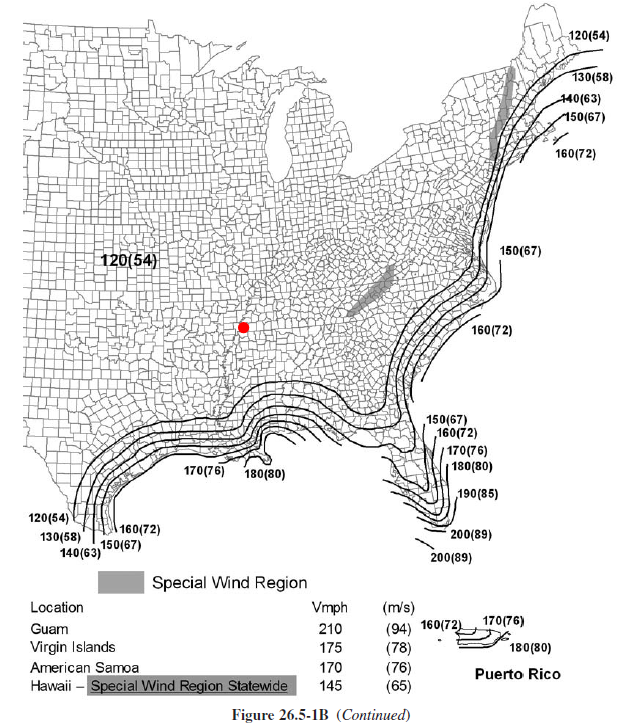
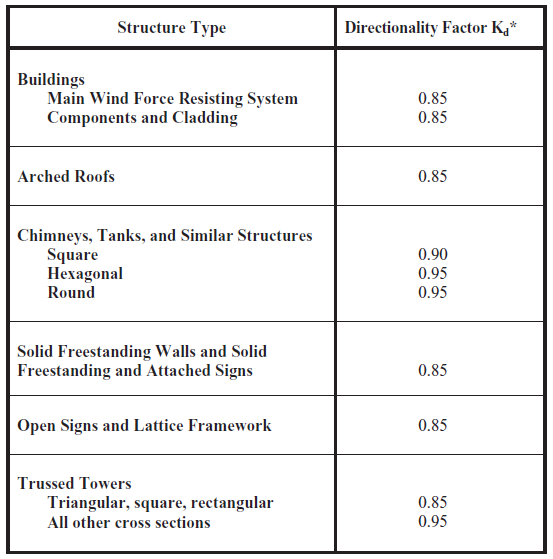
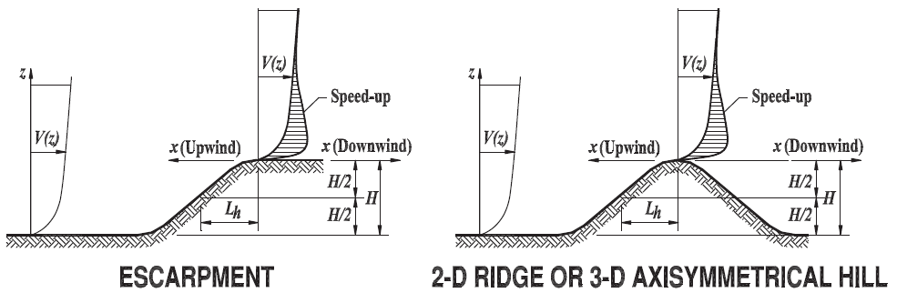
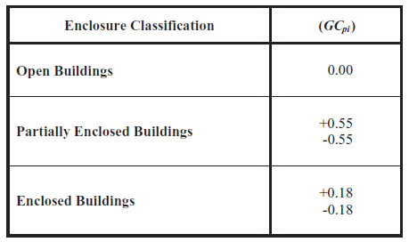
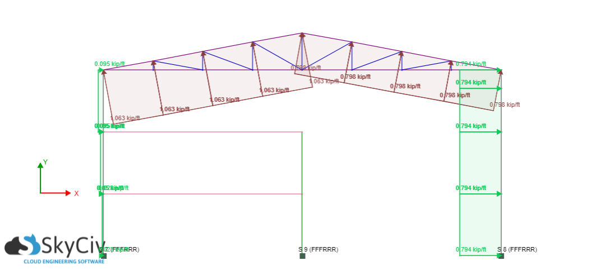
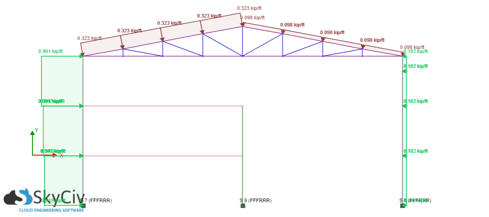
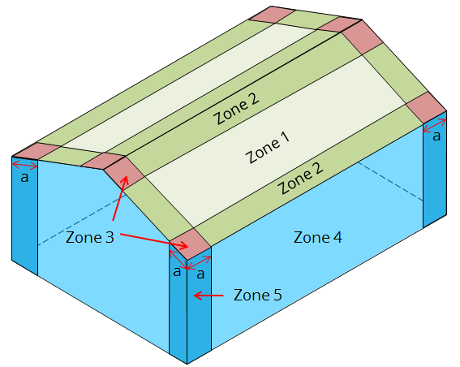
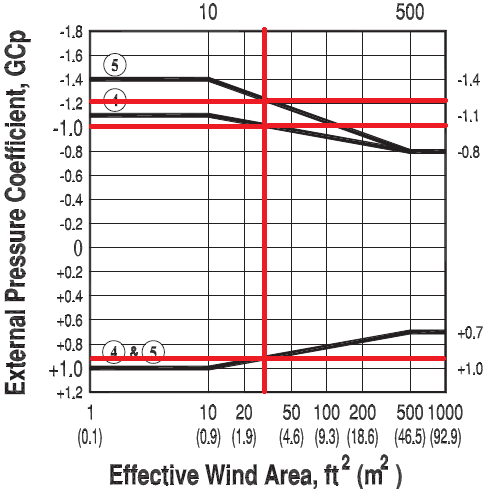
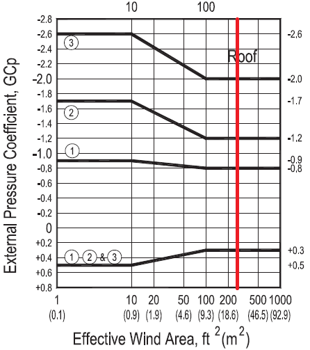

# Example 2: Three-story plant structure (ASCE 7-10 Ch. 27, partially enclosed)

**Source:** SkyCiv technical notes, *ASCE 7-10 Wind Load Calculation Example*, by Patrick Aylsworth Garcia (Structural Engineer, Product Development, SkyCiv). The article cites Mehta & Coulbourne, *Wind Loads: Guide to the Wind Load Provisions of ASCE 7-10* (ASCE, 2013) and ASCE/SEI 7-10.

The text, tables and figures below are imported from that article, and the figures are copied here. The article's Figure 2, a Google Maps satellite image of the site, was left out on purpose: it is third-party map imagery and has no engineering content.

**Why this one:** it was written by a different author, under a different edition, with a partially enclosed building (GCpi ±0.55) and three floors. It gives:
- design pressures at each floor;
- both roof directions, with an interpolation table at θ = 10.62°;
- C&C wall and roof pressures.

ASCE 7-10 Chapter 27 is ASCE 7-16's: the same q = 0.00256 Kz Kzt Kd V² and Ke = 1. The tests run it as ASCE 7-16.

---

## Building data (Table 1)

| | |
|---|---|
| Location | Cordova, Memphis, Tennessee |
| Occupancy | Miscellaneous – Plant Structure (Risk Category IV) |
| Terrain | Flat farmland (Exposure C, Kzt = 1.0) |
| Dimensions | 64 ft × 104 ft in plan, eave height 30 ft, apex at 36 ft, roof slope 3:16 (10.62°), with opening |
| Cladding | Purlins spaced at 2 ft, wall studs spaced at 2 ft |

*Figure 1: the warehouse model (64 ft × 104 ft, 30 ft eave). Trusses span the 64 ft; the ridge runs along the 104 ft.*

## Formulas

- Enclosed and partially enclosed buildings: p = q·G·Cp − qi·(GCpi) (1)
- q = 0.00256·Kz·Kzt·Kd·V² (3)
  - q = qh for leeward walls, side walls and roofs;
  - q = qz for windward walls at height z;
  - qi = qh (conservative).

## Parameters

- **V = 120 mph** (Fig. 26.5-1B, Risk Category IV).

  

- **Kd = 0.85** (Table 26.6-1).

  

- **Kzt = 1.0:** flat farmland (Fig. 26.8-1 not needed).

  

- **Kz** = 2.01(z/zg)^(2/α), with z not less than 15 ft. Exposure C: α = 9.5, zg = 900 ft.
- **G = 0.85** (rigid).
- **GCpi = ±0.55** (partially enclosed, Table 26.11-1).

  

Mean roof height h = (30 + 36)/2 = 33 ft. The windward wall is taken as uniform between floor levels.

Tables 4 and 5:

| Elevation (ft) | Kz | q (psf) | Remarks |
|---|---|---|---|
| 10 | 0.85 | 26.63 | 1st floor |
| 20 | 0.90 | 28.20 | 2nd floor |
| 30 | 0.98 | 30.71 | Roof eave |
| 33 | 1.00 | 31.33 | Roof mean height, qh |

## External pressure coefficients (Fig. 27.4-1)

h = 33 ft, L = 64 ft, B = 104 ft. L/B = 0.615, h/L = 0.516, h/B = 0.317.

Table 6, walls:

| Surface | Cp |
|---|---|
| Windward wall | 0.8 |
| Leeward wall | −0.5 |
| Side wall | −0.7 |

Table 7, roof, wind along L (normal to the ridge):

| h/L | Windward 10° | Windward 10.62° | Windward 15° | Leeward 10° | Leeward 10.62° | Leeward 15° |
|---|---|---|---|---|---|---|
| 0.5 | −0.9 / −0.18 | −0.88 / −0.18 | −0.7 / −0.18 | −0.50 | −0.50 | −0.50 |
| **0.516** | −0.91 / −0.18 | **−0.89 / −0.18** | −0.71 / −0.18 | −0.51 | **−0.51** | −0.50 |
| 1.0 | −1.3 / −0.18 | −1.26 / −0.18 | −1.0 / −0.18 | −0.70 | −0.69 | −0.60 |

Table 8, roof, wind along B (parallel to the ridge), h/B = 0.317:

| Location | Cp |
|---|---|
| 0 to h/2 | −0.9 / −0.18 |
| h/2 to h | −0.9 / −0.18 |
| h to 2h | −0.5 / −0.18 |
| > 2h | −0.3 / −0.18 |

## Design wind pressures, MWFRS

Table 9, walls (psf):

| Floor elevation | qz | Windward +GCpi | Windward −GCpi | Leeward +GCpi | Leeward −GCpi | Side +GCpi | Side −GCpi |
|---|---|---|---|---|---|---|---|
| 10 | 26.63 | 0.88 | 35.35 | −30.55 | 3.92 | −35.88 | −1.41 |
| 20 | 28.20 | 1.94 | 36.41 | | | | |
| 30 | 30.71 | 3.65 | 38.12 | | | | |
| 33 | 31.33 | 4.07 | 38.54 | | | | |

Table 10, roof (psf). The along-B columns are garbled on the source page; only the clear values are given.

| Along L | +GCpi | −GCpi |
|---|---|---|
| Windward (Cp −0.89) | −40.87 | −6.41 |
| Windward (Cp −0.18) | −22.03 | 12.44 |
| Leeward | −30.71 | 3.76 |

| Along B | +GCpi |
|---|---|
| 0 to h/2 | −41.20 |
| h/2 to h | −41.20 |
| h to 2h | −30.55 |
| > 2h | −25.22 |

Bay length is 26 ft.

*Figure 7: one frame, wind along L, +GCpi, the largest roof pressure case.*

*Figure 8: one frame, −GCpi, the largest roof pressure case.*

## Components and cladding (Ch. 30, ASCE 7-10 Fig. 30.4-1 and 30.4-2B)

p = qh[(GCp) − (GCpi)], with qh = 31.33 psf.

a = min(10% of 64 = 6.4, 0.4·33 = 13.2) = 6.4 ft. It must be at least 4% of 64 = 2.56 ft and at least 3 ft, so **a = 6.4 ft**.

**Wall studs:** effective area = max(10 × 2, 10 × 10/3) = 33.3 ft².

| Zone | +GCp | −GCp | p, +GCp (psf) | p, −GCp (psf) |
|---|---|---|---|---|
| 4 | 0.90 | −1.0 | 10.97 / 45.43 | −48.56 / −14.10 |
| 5 | 0.90 | −1.2 | 10.97 / 45.43 | −54.83 / −20.36 |

**Purlins:** span 26 ft, effective area = max(26 × 2, 26 × 26/3) = 225.33 ft².

| Zone | +GCp | −GCp | p, +GCp (psf) | p, −GCp (psf) |
|---|---|---|---|---|
| 1 | 0.30 | −0.80 | −7.83 / 26.63 | −42.30 / −7.83 |
| 2 | 0.30 | −1.2 | −7.83 / 26.63 | −54.83 / −20.36 |
| 3 | 0.30 | −2.0 | −7.83 / 26.63 | −79.89 / −45.43 |

---

## What the tests check (`ASCE7Wind.Tests/PublishedExampleTests.cs`, `Ex2_*`)

Model: 64 ft (x) × 104 ft (y), levels at 10, 20 and 30 ft, gable pitch atan(3/16) with the ridge S-N (along the 104 ft), partially enclosed, V 120, Exposure C, ASCE 7-16.

| Test | Published | Result |
|---|---|---|
| h, qz at 10 / 20 / 30 ft, qh, GCpi | 33; 26.63; 28.20; 30.71; 31.33; 0.55 | **pass** (within 0.1 psf) |
| Roof Cp along L: −0.89 / −0.18 windward, −0.51 leeward | as above | **pass** |
| Roof Cp along B: −0.9 / −0.9 / −0.5 / −0.3, −0.18 | as above | **pass** |
| 14 design pressures from Tables 9 and 10 (along L) | as above | 11 **pass**; 3 **fail by 0.06 to 0.08 psf** |

The three misses:
- windward wall at 10 ft, +GCpi: 0.88 published, 0.82 computed;
- leeward wall, +GCpi: −30.55 published, −30.62 computed;
- side wall, +GCpi: −35.88 published, −35.96 computed.

**These come from the example's rounding, not the program.** The article rounds Kz to two places (Kh = 1.00, qh = 31.33). The power law gives Kh = 1.002, qh = 31.40, so qh·GCpi = 17.27 rather than 17.23. On the +GCpi side that 0.04 to 0.08 psf shows in values that are small differences of two numbers near 18. The program's formula is the article's (qz for the windward wall at each height, qh for the rest and for the internal pressure).

**Not tested:** the C&C pressures. ASCE 7-16 replaced the 7-10 roof C&C figure used here (Fig. 30.4-2B) with new zones and values (Fig. 30.3-2C...), so the roof numbers can't be compared across editions. The wall values (zones 4 and 5) could be; that test is still to be added.
